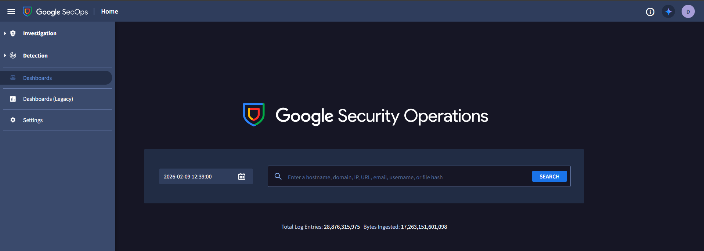
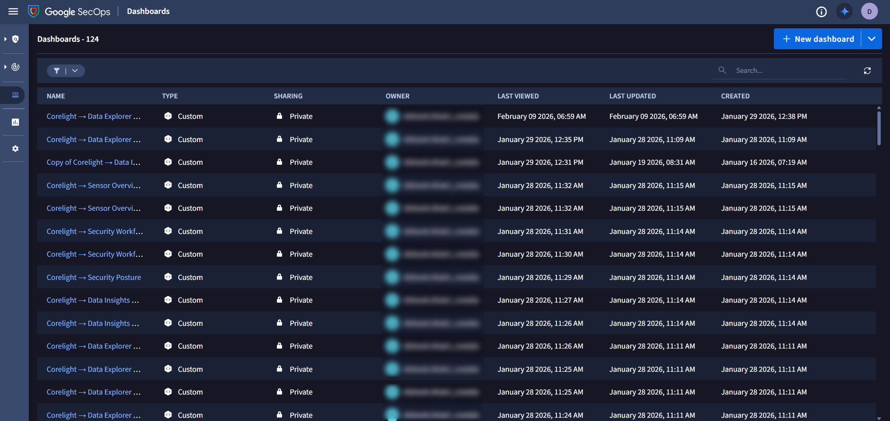
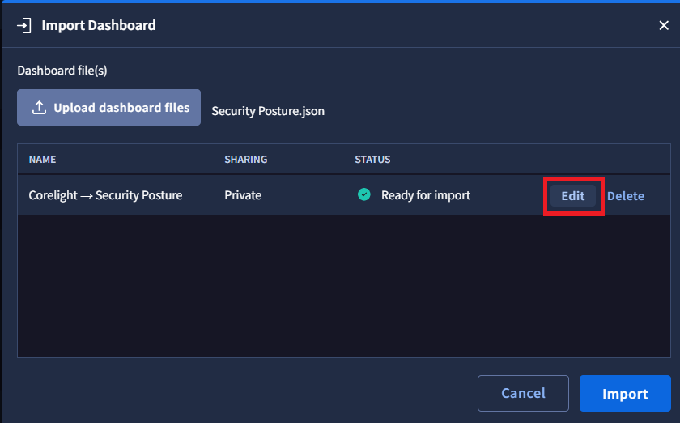
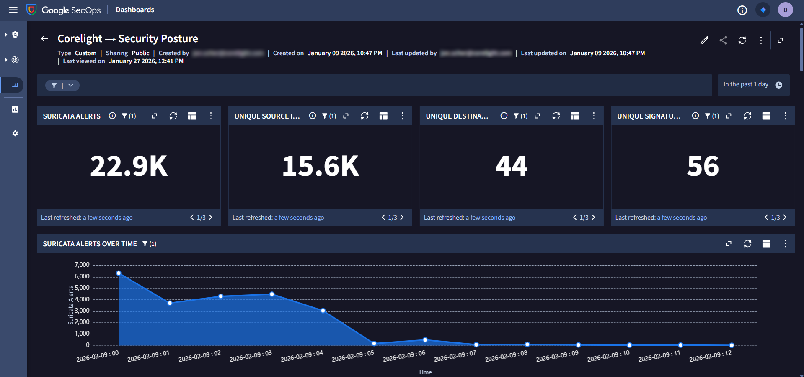

# Google SecOps Dashboards for Corelight

## Overview

This guide provides step-by-step instructions for setting up and utilizing **Google SecOps Dashboards** to monitor and analyze network traffic data. By leveraging the capabilities of Chronicle Backstory, these dashboards deliver scalable, real-time insights across your organization's infrastructure, enhancing your security operations and visibility.

## Pre-requisites

Before you begin, ensure the following prerequisites are met:

- **Google SecOps Platform Access:** You must have an active account with access to the Google SecOps platform.
- **Google SecOps Dashboards Access:** Ensure you have the necessary permissions to access and create custom dashboards in the dashboards section.
- **GitHub Repository Access:** Ensure you have access to the [CorelightForSecOps](https://github.com/corelight/CorelightForSecOps/tree/main) GitHub repository, which includes the necessary dashboard configuration files. Also, verify that the required parsers are enabled and logs are sent to Google Security Operations using Corelight Sensor which is stated [here](https://github.com/corelight/CorelightForSecOps/blob/main/README.md).

## Installation & Configuration

### Reference lists and data tables required by dashboards

Some dashboards look up values in Google SecOps reference lists or data tables. Create these before you import the dashboards that use them. If one is missing, the charts that use it return no data.

The names are case-sensitive and must match the table below exactly, because the dashboard queries refer to them by name (for example, `%corelight_use_cases.use_case`).

| Name | Type | Used by dashboard(s) | Contents |
|------|------|----------------------|----------|
| `internal_cidr_list` | Reference list (CIDR) | Security Posture, Secure Channel Insights, Name Resolution Insights, Files, SSL | Your internal IP CIDR ranges (see the section below). |
| `corelight_ai_apps` | Reference list (String) | AI Detection & Response | Identifiers of the GenAI applications to track. |
| `corelight_use_cases` | Data table | Anomaly Detection, Anomaly Detection Details | Describes each Corelight anomaly detection use case. Columns: `target_dashboard`, `use_case`, `description`, `significance`, `baseline_behavior`, `anomalous_behavior`. |

#### Create a reference list (For identifying Internal/External IPs)

1. Head over to the **Google SecOps** Platform


2. From the left side menu go to **Detections -> Lists** Section


3. Now a List manager popup will appear. Click on **Create** button for creating a new List.


4. In the popup, select the **Syntax type** of the list as **CIDR** and name the title of the list as **internal_cidr_list**. Also, add the **IP CIDR range** (as per your requirement) in the last section.


5. Finally, Click on **Save Edits** from the bottom right corner and your CIDR list will be created.


#### Create the `corelight_ai_apps` reference list

The **AI Detection & Response** dashboard only shows Corelight `conn` events whose application identifier is in this list.

1. In Google SecOps, go to **Detections -> Lists** and click **Create**.
2. Set **Syntax type** to **String** and set the title to **corelight_ai_apps**.
3. Add one GenAI application identifier per line and click **Save Edits**.

The dashboard's Risk Tier and Corporate Origin charts classify the identifiers below. Start from this list and add or remove entries to suit your environment:

<details>
<summary>Suggested <code>corelight_ai_apps</code> entries</summary>

```
chatgpt
google-gemini
claude
anthropic
openai
cursor
ollama
github
grok
huggingface
perplexity
sora
moonshot
zhipu-ai
alibaba-qwen
baidu-ernie
bytedance-doubao
minimax
01ai-yi
sensetime
iflytek-spark
baichuan-ai
stepfun
openrouter
litellm
braintrust
portkey
helicone
github-copilot
codeium
tabnine
sourcegraph-cody
amazon-q
mistral
cohere
deepseek
groq
together-ai
fireworks-ai
replicate
ai21
inflection-pi
lepton-ai
octoai
meta-ai
deepl
forefront-ai
adept-ai
otter-ai
fireflies-ai
notion-ai
krisp
tldv
fathom
read-ai
mem-ai
crewai
zapier-ai
midjourney
stability-ai
runwayml
elevenlabs
pika
synthesia
suno
udio
microsoft-copilot
you-ai
phind
character-ai
kagi
nvidia-ngc
gpt4all
langsmith
pinecone
chroma
wandb
baseten
modal
weaviate
scale-ai
datarobot
adobe-firefly
poe
leonardo-ai
lakera
arthur-ai
```

</details>

#### Create the data tables

Data tables are imported from a file. Supported formats are **CSV** (comma-separated values, `.csv`) and **TSV** (tab-separated values, `.tsv`). The first row of the file must be a header row whose column names match the columns listed below.

1. In Google SecOps, go to **Investigation -> Data Tables**.
2. Create a new data table and set its name to the exact name shown below.
3. You can either type data manually or import your `.csv` or `.tsv` file and save the data table.

**`corelight_use_cases`**

| Column | Description |
|--------|-------------|
| `target_dashboard` | Name of the dashboard that shows the details for this use case. |
| `use_case` | Corelight anomaly use case name. It is matched against the `use_case` field of the `anomaly` log (`security_result.rule_name` in UDM). |
| `description` | What the use case detects. |
| `significance` | Why an anomaly from this use case matters. |
| `baseline_behavior` | What the use case learns during its baselining period. |
| `anomalous_behavior` | What behavior raises the anomaly. |

<details>
<summary>Suggested <code>corelight_use_cases</code> entries</summary>

```
target_dashboard,use_case,description,significance,anomalous_behavior,baseline_behavior
corelight_insights_anomaly_details_http_user_agents,http_user_agents,A host is observed using an anomalous or unexpected HTTP user agent. This could indicate unauthorized or malicious activity on the network.,"The use of an anomalous HTTP user agent can indicate unauthorized access or malicious activity, as adversaries might employ user agents that are either non-standard or atypical for the given host.",":original_entity: used :item:, a user agent they and similar entities had not used during baselining",:entity: used :entity_training_items_combined: for HTTP connections during baselining
corelight_insights_anomaly_details_ssh_connections,ssh_connections,A host established an SSH connection to an unexpected subnet. This may indicate lateral movement or unauthorized access attempts.,Anomalous SSH connections to unexpected subnets can indicate lateral movement by adversaries or unauthorized access to sensitive resources.,":original_entity: established an SSH connection to subnet :item:, a destination they and similar entities had not connected to during baselining",:entity: established SSH connections to these :entity_training_items_combined: during baselining
corelight_insights_anomaly_details_ssh_clients,ssh_clients,A host established an SSH connection using an unexpected or anomalous SSH client. This could indicate the use of malicious tools or unauthorized access.,"The use of an anomalous SSH client can indicate malicious activity, as adversaries might employ SSH clients that are either non-standard or atypical for the given host.",":original_entity: used SSH client :item:, an SSH client they and similar entities had not used during baselining",:entity: used :entity_training_items_combined: during baselining
corelight_insights_anomaly_details_ew_servers_services,ew_servers_services,"A host communicated with another internal subnet over an anomalous or unexpected network service, indicating potential lateral movement or misconfiguration.",Anomalous services between internal subnets can indicate lateral movement by adversaries or unauthorized access to resources.,":original_entity: used :item:, a service they and similar entities had not used during baselining",:entity: communicated with internal subnet using :entity_training_items_combined: during baselining
corelight_insights_anomaly_details_ns_servers_services,ns_servers_services,An internet-facing server found in connections with an unexpected network service. This may indicate exploitation or misconfiguration.,Internet-facing servers can be exploited by adversaries to gain unauthorized access or disrupt operations.,":original_entity: used :item:, a service they and similar entities had not used during baselining",:entity: used :entity_training_items_combined: during baselining
corelight_insights_anomaly_details_rdp,rdp,A host established an RDP connection to an unexpected subnet using an unusual SSL/TLS fingerprint.,"Anomalous RDP connections to unexpected destinations can indicate lateral movement by adversaries, unauthorized remote access, or compromise of legitimate credentials for unauthorized system access.",":original_entity: used RDP or Port 3389/tcp to connect to :item: for at least 15 seconds, a subnet to which it had unexpectedly connected using an unusual SSL/TLS fingerprint",:entity: used :entity_training_items_combined: during baselining
corelight_insights_anomaly_details_admin_shares,admin_shares,"A host accessed an unexpected administrative network share (ADMIN$, IPC$, SYSVOL, NETLOGON).","Anomalous administrative share access can indicate lateral movement by adversaries or unauthorized access to sensitive administrative resources and network infrastructure.",":original_entity: unexpectedly accessed :item:, an administrative network share (ADMIN$, IPC$, SYSVOL, NETLOGON) in a way that deviated from its baseline",:entity: used :entity_training_items_combined: during baselining
corelight_insights_anomaly_details_exe_files,exe_files,"A host downloaded an unexpected executable file from an external or internal source.","Anomalous executable downloads can indicate malicious tool transfer, malware distribution, or unauthorized software installation that could be used for persistence or lateral movement.",":original_entity: transferred :item:, an executable file they and similar entities had not used during baselining",:entity: used :entity_training_items_combined: during baselining
```

</details>

> **Note:** Several charts in **Anomaly Detection** (Anomalies Observed, Anomaly Summary, Detections per Anomaly Type over Time, Detection Breakdown by Anomaly Type and Source IP) and most panels in **Anomaly Detection Details** only show anomalies whose `use_case` has a row in this table. Add a row for every use case that is enabled on your sensors.


### Deploy Dashboards from GitHub Repository

To set up the SecOps Dashboards, you'll need to deploy them from the [CorelightForSecOps](https://github.com/corelight/CorelightForSecOps/tree/main) GitHub repository. Follow these steps to do so:

### Step 1: Download Dashboard Configuration Files from GitHub

- Navigate to the [CorelightForSecOps](https://github.com/corelight/CorelightForSecOps/tree/main) GitHub repository and head over to the [dashboards](https://github.com/corelight/CorelightForSecOps/tree/develop/dashboards) folder.
- Download the JSON configuration files for the dashboards to your local machine.


### Step 2: Open Google SecOps and Navigate to Dashboards

- Launch the Google SecOps platform in your preferred browser.
- Navigate to the Dashboards section in the interface.
- In the Dashboards section, you will see a list of custom dashboards.





### Step 3: Import the downloaded dashboards

- In the top-right corner, click the downward arrow next to the New Dashboard button.
- Select Import from JSON from the dropdown menu.


### Step 4: Upload the Desired Dashboard JSON File

- A dialog will prompt you to upload a file. Click on **Upload dashboard files**.
- Browse your local system and select the desired JSON file from the downloaded configurations.
- Click **Import** to complete the upload.


### Step 5: Rename the Imported Dashboard (Optional)

- When importing a dashboard from your local machine, after selecting the file in the pop-up window, click the **Edit** button next to the selected dashboard file and rename it according to your preference and click on **Save** button.
- Also, you can change the access of your dashboard to public or private based on your preferences.
- Lastly, click on **Import** after editing the name.




### Step 6: Access and View Your Imported Dashboard

- Use the search bar to locate the newly imported dashboard by name.
- Click on the dashboard to view its contents, including charts, graphs, and real-time data visualizations.



After clicking on the dashboard you imported, you will be able to view your dashboard based on your instance data.
